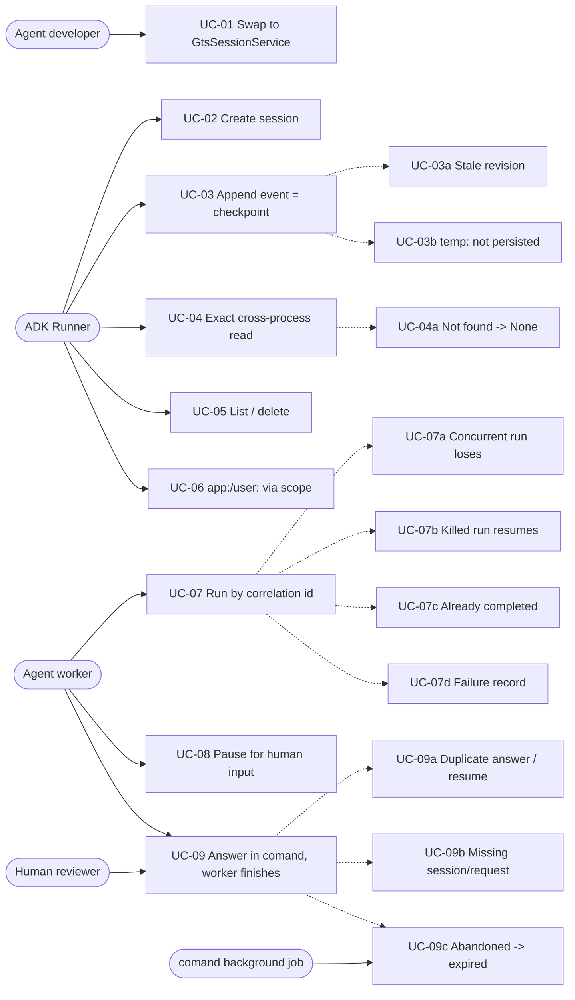
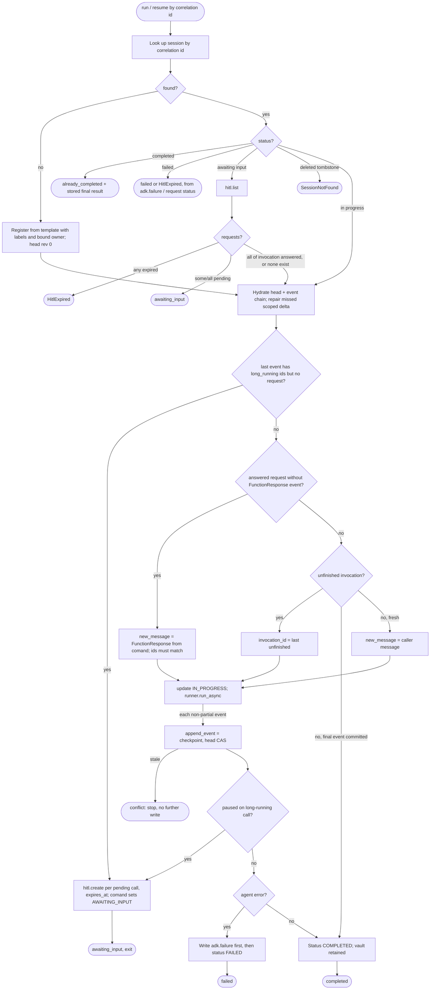
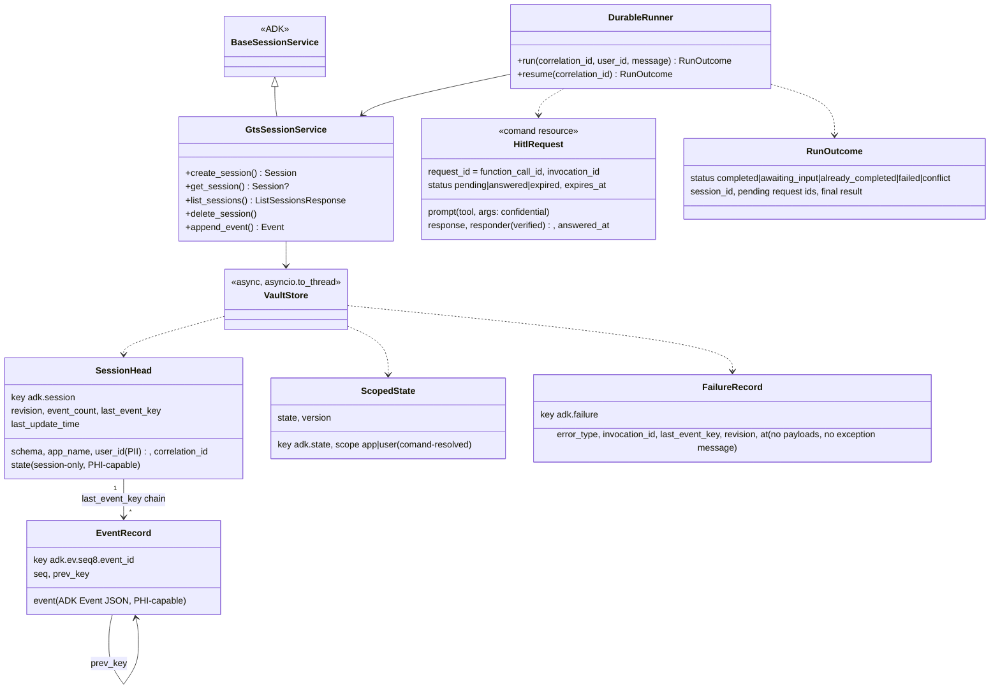
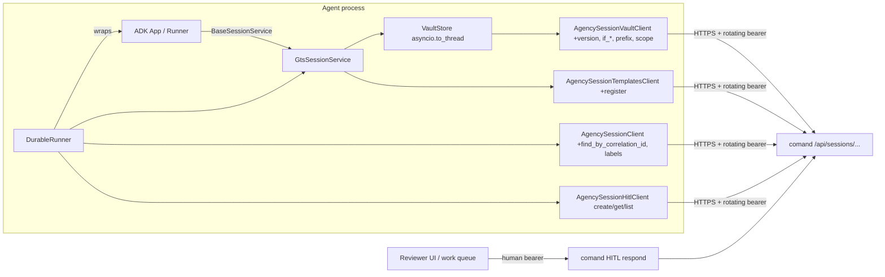
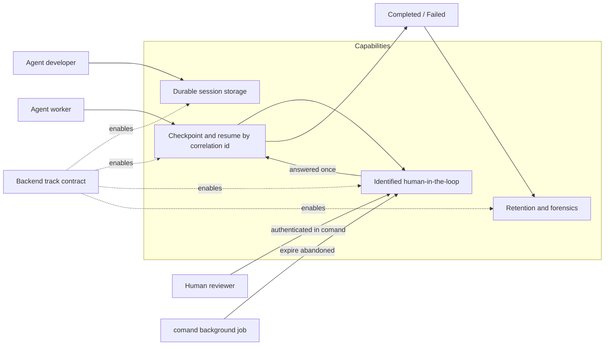
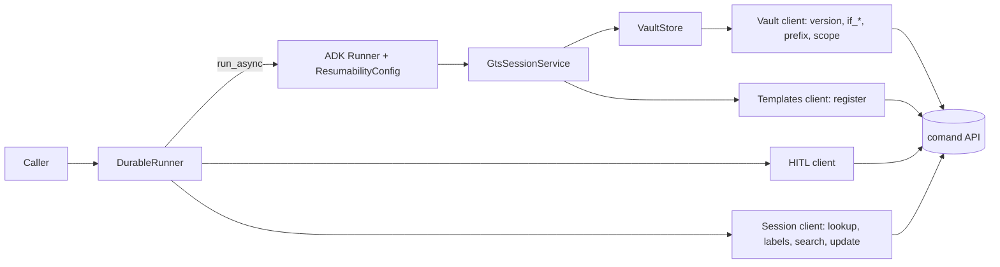
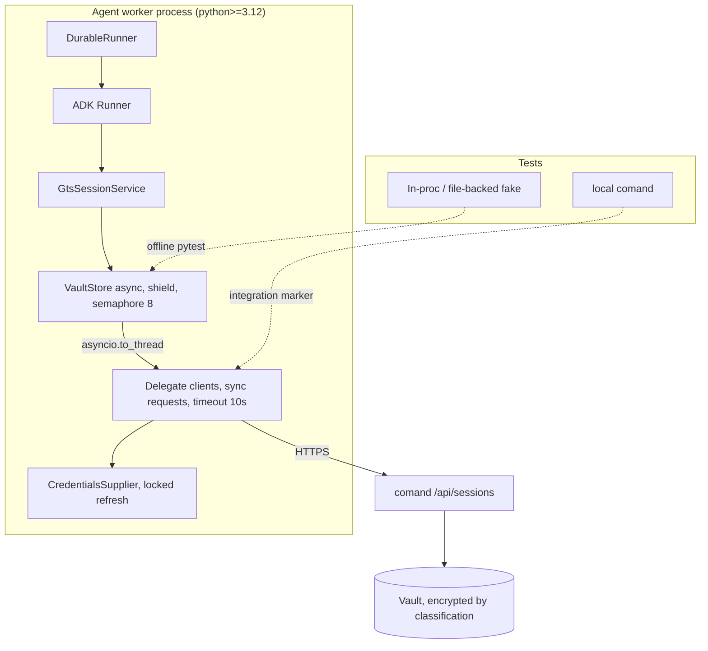
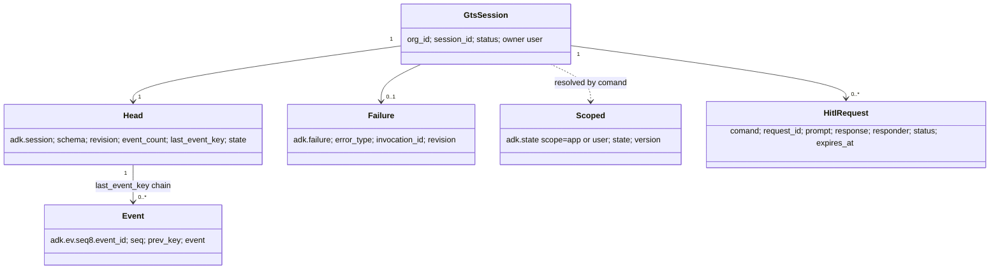
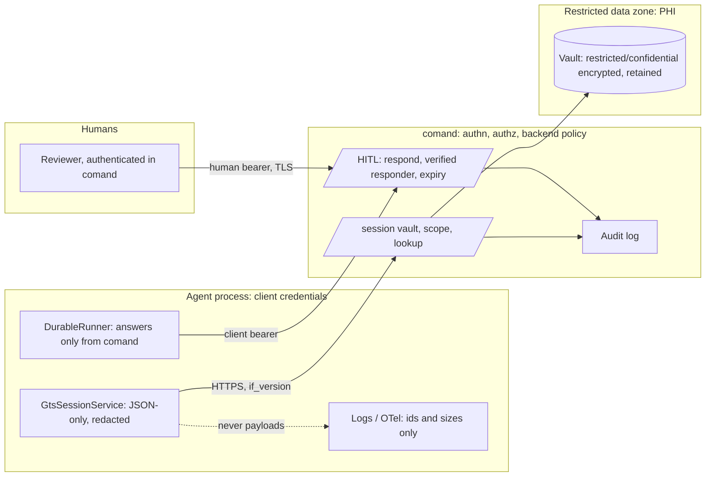

# Design: Agent Vault — GTS-backed Google ADK 2 sessions (SDK half)

## Overview
ADK 2 agents keep their sessions in `InMemorySessionService`, so state dies with the process. This track adds `GtsSessionService`, an ADK 2 session service (`google-adk>=2.11,<3`) that persists each session in its GTS session vault.

On top of it, `DurableRunner` adds two things:
- **Correlation-id resume:** a killed run continues from its last checkpoint.
- **Human-input pause and continue (HITL):** a human answers **through comand as an authenticated user**.

Both build on ADK's own resumability and long-running tools. All storage goes through comand's session APIs, so backend policy always knows the user. The backend half is the separate track `agent_vault_backend_20261012`, and this design fixes its contract. Detail: [`docs/agent_vault_gap_analysis.md`](../../../../docs/agent_vault_gap_analysis.md).

## Actors
- **Agent developer:** configures the session service.
- **ADK Runner** *(system)*: calls `BaseSessionService`.
- **Agent worker** *(system)*: runs an agent for a correlation id. It is re-dispatched to resume.
- **Human reviewer:** answers a pending request in comand, authenticated as themselves.
- **comand** *(external)*: the session vault, HITL requests, policy, and request expiry (its background-job task).

## Use Cases
| ID | Use case | Actor |
|---|---|---|
| UC-01 | Swap `InMemorySessionService` for `GtsSessionService` by configuration only | Agent developer |
| UC-02 | Create a session: register a GTS session from a named template, or adopt a given id | ADK Runner |
| UC-03 | Append an event and its state delta. This is the **checkpoint** write | ADK Runner |
| UC-03a | The stored revision has moved on: `StaleSessionError`, and nothing is overwritten | ADK Runner |
| UC-03b | `temp:` state is applied in memory but never persisted | ADK Runner |
| UC-04 | Another process reads the session back exactly (events and state; `num_recent_events`/`after_timestamp`) | ADK Runner |
| UC-04a | Unknown session: returns `None` | ADK Runner |
| UC-05 | List sessions by app (and user, with comand filtering by policy); delete a session's ADK data | ADK Runner |
| UC-06 | Read and write `app:`/`user:` state through the session vault's `scope`; comand resolves the app and user | ADK Runner |
| UC-07 | Run by correlation id: look it up, then hydrate and resume, or create | Agent worker |
| UC-07a | A concurrent run with the same correlation id loses the CAS and stops without writing | Agent worker |
| UC-07b | A run killed mid-way resumes its last unfinished invocation without repeating completed steps | Agent worker |
| UC-07c | The correlation id's run already completed: return its stored final result and do not run again | Agent worker |
| UC-07d | The run fails: write a PHI-free `adk.failure` record and mark the session FAILED; history is kept | Agent worker |
| UC-08 | Pause for human input: create the pending request in comand (which sets `AWAITING_INPUT`) and exit | Agent worker |
| UC-09 | The human answers in comand (identity recorded); a re-dispatched worker resumes and finishes | Human reviewer, Agent worker |
| UC-09a | Duplicate answer is refused by comand (first wins); a duplicate resume injects nothing twice | Human reviewer, Agent worker |
| UC-09b | Session or request missing: typed error, nothing written | Agent worker |
| UC-09c | Abandoned request: comand's background job expires it and fails the session; a late resume gets `HitlExpired` | comand, Agent worker |

## Activity
`run` and `resume` share this flow; `resume(correlation_id)` is `run` without a new message. A correlation id is **one run**. FAILED and COMPLETED are terminal in comand, so a retry uses a new correlation id. Transient outages leave the session `IN_PROGRESS` instead of failing it.

## Class

## Component

## Architecture

### Business Architecture
Long clinical agents survive restarts, resume by correlation id, and pause for an identified human.

Stakeholders and what they own:
- **Agent developers** adopt it by configuration.
- **The backend team** owns the contract, the HITL endpoints and the retention policy; request expiry is its existing background-job task.
- **The reviewer UI / work-queue owner** wires the human answer and the re-dispatch. That wiring is out of this track's scope; the example simulates it.
- **Reviewers** answer as themselves.
- **Compliance** is involved because PHI is now retained past terminal status.

Business rules: one ADK session is one GTS session; content is `restricted` by default; a request is answered once, by an identified human; stale writers lose; history is retained for forensics under a backend retention policy.

Success measures:
- share of resumed runs repeating no steps
- median pause-to-answer time
- count of expired requests

**Decisions**
- Build on ADK's resumability and long-running tools rather than wrapping them.
- Human answers are recorded in comand under the reviewer's own identity, never asserted by a client.
- One ADK session is one GTS session, with one audit and billing identity.
- The vault is retained after terminal status, so failures can be diagnosed; retention is backend-owned.
- `google-adk` ships as an optional `[adk]` extra pinned `>=2.11,<3`.

**Risks**
- Retained PHI widens the HIPAA surface; the retention and erasure policy is a release gate.
- Abandoned requests depend on comand's background-job task shipping.
- ADK 2 churn could force rework.

### Application Architecture
`agency_sdk/adk/` (the `[adk]` extra, lazy-imported) adds three components:
- **`VaultStore`** is the only vault HTTP seam. It wraps the sync client with `asyncio.to_thread` and maps 409/412 to `StaleSessionError`.
- **`GtsSessionService`** handles the checkpoint. **Append:** trim `temp:`, PUT the event `if_absent`, CAS the head `if_version`. Only after the head commits does it mutate the in-memory session and set `_storage_update_marker = str(version)`. Then it applies `app:`/`user:` deltas through `scope` as a per-key merge, retried on 412. Scope writes are outside the head guarantee. A missed delta is re-applied by the next **run** (a write path, never `get_session`), last-writer-wins per key. A loser never touches scope. **Read:** a bounded `prev_key` walk for `num_recent_events`, otherwise a prefix list plus parallel GETs linked by `prev_key`, which drops orphans. `create_session` on an existing id raises `AlreadyExistsError`. `delete_session` writes a tombstone on the head, after which `get` returns `None`; physical removal follows the retention policy.
- **`DurableRunner`** follows the Activity flow; the committed `FunctionResponse` event is the dedup marker.

| SDK method | HTTP (`?o=<org>`) | Contract |
|---|---|---|
| `vault.get(..., scope=None)` → `+version` | `GET /api/sessions/{sid}/vault/{key}[?scope=app\|user]` | monotonic per-key `version` |
| `vault.set(..., *, if_version, if_absent, scope)` | `PUT …/vault/{key}?if_version=n\|if_absent=true` | 412 mismatch, 409 exists |
| `vault.list(..., *, prefix, page, size)` | `GET …/vault?prefix=` | lexicographic, paged |
| `session_templates.register(org, name, *, correlation_id, labels, input)` | template `_command` `register` | correlation id unique per org (409 + existing id) |
| `sessions.find_by_correlation_id(org, cid)` | `POST /api/sessions/_lookup` (id in body) | 404 for both miss and foreign |
| `sessions.update(..., labels=)` | `_command` `update` | labels on adopted sessions |
| `sessions.search(org, labels, user=)` | `POST /api/sessions/_search` | policy-filtered |
| `hitl.create(org, sid, request_id, invocation_id, prompt, expires_at)` | `POST /api/sessions/{sid}/hitl` | idempotent on `request_id`; sets `AWAITING_INPUT` atomically |
| `hitl.get` / `hitl.list(org, sid, status=)` | `GET /api/sessions/{sid}/hitl[/{rid}]` | response and verified `responder` |
| `hitl.respond(org, sid, rid, response)` *(human token)* | `POST …/hitl/{rid}/_respond` | first wins (409); 410 expired; policy-authorised human |

**Decisions**
- Per-key conditional writes only; the head CAS is the sole commit point.
- HITL requests are a comand resource, so comand owns identity, dedup and expiry.
- When one invocation has several pending requests, it resumes only once **all** are answered.
- Conditional writes pass `retry=True`. A 412 or 409 after a retry is re-read: if the stored key or event id is ours, the write succeeded.
- Core delegates only gain additive keyword parameters. `AgencySessionClient` still never registers.

**Risks**
- Head-CAS contention between a run and a resume.
- Hydrating a long session costs O(all keys).
- The backend is unbuilt, so the contract may drift; the TS-40 probe catches that.

### Technical Architecture
Retries follow the base client's documented policy:
- Connection errors are retried with backoff. Conditional writes opt in with `retry=True`.
- Read timeouts and 5xx responses are **not** retried, so the run fails closed at its last checkpoint and resumes later (UC-07b).

Two additive core changes:
- `timeout=` per call, which the store sets to 10 s.
- A `threading.Lock` around the token refresh in `CredentialsSupplier`, so concurrent threads fetch one token.

The checkpoint `await` is `asyncio.shield`ed. After a cancellation the head state is unknown and is re-read. Parallel GETs are capped by a semaphore of 8. Tests run offline against an in-process or file-backed fake; an opt-in suite runs against local comand.

**Decisions**
- A lazy `[adk]` extra; a CI job `[dev,adk,observability]` plus `pip check` proves the OTel pins coexist.
- Retry policy is unchanged from the base client; only an additive `timeout=` is added.
- Token refresh is locked with a double-checked refresh.
- Checkpoints are shielded from cancellation; a cancelled run re-reads the head.
- Targets are checkpoint p95 ≤300 ms and hydrate ≤1 s for 50 events, recorded by a manual benchmark.

**Risks**
- Each checkpoint costs 2 round trips.
- A comand outage halts progress (fails closed).
- The `[adk]` extra is heavy and pins OTel to `<=1.42.1`.
- The offline fake can drift from comand.

### Data Architecture
comand's vault is the source of truth and is **retained after terminal status**. Session keys:
- the **head** `adk.session`, which holds `last_event_key`, counters and session state
- immutable **events** `adk.ev.<seq8>.<event_id>`, each linked by `prev_key`
- a PHI-free **`adk.failure`** record

`app:`/`user:` state lives in `adk.state` under `scope=app|user`. comand resolves the app and user from the session, so a client can never name another user. HITL requests are a comand resource. `temp:` is never persisted.

For an exact round-trip, events are written with `model_dump_json(by_alias=True)`, with no `exclude_none`, and read with **`model_validate_json`**. ADK's `val_json_bytes='base64'` only applies in JSON mode, so this keeps bytes intact. Head state must be JSON-native; anything else is rejected with a typed error. The head carries `schema`, and an unknown future schema version fails closed.

| Key / resource | Contents | PHI/PII | Classification | Retention |
|---|---|---|---|---|
| `adk.session` | ids, correlation id, revision, session state | PHI possible; `user_id` PII | restricted | backend retention policy |
| `adk.ev.<seq8>.<id>` | messages, tool calls/results, bytes | PHI (high) | restricted | backend retention policy; orphans included |
| `adk.failure` | error type, ids, counts | none (by construction) | restricted | backend retention policy |
| `adk.state` scope=user | per-user state | PII, PHI possible | restricted | user lifetime; subject erasure |
| `adk.state` scope=app | app-wide state | PHI forbidden | restricted (`internal` by explicit opt-in) | app lifetime |
| HITL request | prompt args, response, responder | PHI, PII | confidential (audited reveal for reviewers) | backend retention policy |

**Decisions**
- State stays in the head, so there is one atomic commit point.
- Events are serialised in JSON mode and loaded with `model_validate_json`.
- Scoped state is applied after the head commits, with a per-key merge; it is outside the commit guarantee and repaired on hydrate.
- `public`/`internal` are rejected for every session key; only app scope may opt in to `internal`.
- `adk.failure` holds the exception **type** only, is written idempotently (an existing record is kept) before FAILED, so a crash leaves the session retryable.

**Risks**
- The head grows with state; large `inline_data` should spill to `gtsf://`.
- Retained PHI needs a retention and erasure policy.
- Orphan events accumulate until a retention sweep.
- Re-applying a missed scoped delta is last-writer-wins per key, so it can overwrite a newer value from another session (accepted limit).

### Security Architecture
Writes go through comand's session APIs with client credentials, under org and session scope plus policy. Classification is fixed per key kind; decoding is JSON-only, and the chain walk is bounded.

**HITL authority rests on human identity.** Only a policy-authorised human `_respond`s; comand records the verified responder, takes the first answer, and enforces server-time expiry. User scope is resolved by comand from the session's **bound owner**: register/adopt binds it from the authenticated human or the dispatch claim, and `scope=user` fails closed (4xx) when none is bound. Service principals can never `_respond`; the policy is assignment- or role-based. Re-dispatch carries only the session id. An injected `FunctionResponse` must match the pending request's call and invocation ids. Expiry is audited and alerts.

Correlation ids travel in POST bodies, and URLs are scrubbed from errors. No payload, `user_id` or correlation id reaches logs, traces, exceptions or `repr` (T-007).

**Compliance:** HIPAA §164.312:
- access control: org and session scope, backend policy, classification
- audit: the verified responder and comand's audit log
- integrity: CAS and the event chain
- TLS in transit and encryption at rest
- minimum necessary: a PHI-free failure record and a retention policy

| ID | STRIDE | Threat | Mitigation | Residual |
|---|---|---|---|---|
| TM-01 | S | Forged HITL answer | Only an assigned or role-authorised human `_respond`s (service principals rejected); verified responder; agent reads answers only from comand | Low |
| TM-02 | T | Prompt injection via the answer | Size cap; delivered only as a FunctionResponse | Medium |
| TM-03 | T | Stale or concurrent overwrite | Head `if_version` CAS; append-only events; `StaleSessionError` | Low if backend CAS is atomic |
| TM-04 | R | Unattributable answer | comand-recorded responder and audit | Low |
| TM-05 | T | Replayed or duplicate answer or resume | comand first-wins (409); replay uses the stored response; the FunctionResponse event is the dedup marker | Low |
| TM-06 | I | PHI in logs, traces, exceptions, `repr` | Redacting `repr`; ids/sizes-only logging; URL scrubbing; sentinel test | Medium |
| TM-07 | I | PHI stored as plaintext classification | Fixed table; `public`/`internal` rejected | Low |
| TM-08 | I | Correlation-id enumeration | POST body; same 404 for miss and foreign; high-entropy opaque ids | Low |
| TM-09 | I | Cross-user/app scoped-state leak | Owner bound at register/adopt; `scope=user` fails closed if unbound; not client-addressable | Low (backend policy) |
| TM-10 | E | Human reads restricted data | Backend classification gate; SDK never sets `reveal` | Low |
| TM-11 | T | Malicious stored JSON or chain | JSON + pydantic; size caps; bounded, cycle-checked walk | Low |
| TM-12 | I | Abandoned or retained PHI | Server-time expiry by comand's background job (audited, alerting); retention and erasure policy is a **release gate** | Medium until policy ships |
| TM-13 | D | Event spam or oversized events | Client size cap; event bound; backend rate limits | Low–Medium |
| TM-14 | I | Credential leak | Env/secret store; rotating tokens; least-privilege clients | Medium |

**Decisions**
- Answers are human-bound and recorded by comand; the SDK has no client-asserted answer path.
- Classification is fixed by key kind.
- JSON-only decoding with bounds.
- Redaction is built in, including URL scrubbing.
- Correlation ids are opaque, high-entropy and sent only in POST bodies.

**Risks**
- Retaining data past terminal status widens PHI exposure until the retention policy ships.
- Security depends on backend CAS atomicity and the HITL policy.
- Prompt injection through answers is only partly mitigated.

## Impact Analysis
- **New:** `agency_sdk/adk/`, the `[adk]` extra, and `AgencySessionHitlClient` with its DTOs.
- **Changed (additive):** vault, session and templates clients per the Application table; `base_client` `timeout=`; locked `CredentialsSupplier` refresh. Update CLAUDE.md.
- **Docs and examples:** the gap analysis (Phase 0), `docs/adk_sessions.md`, a README quick-start, `quick_gts_session_service.py`, `quick_durable_hitl.py`.
- **Tests:** an offline fake suite and an opt-in `integration` suite.
- **Cross-repo:** `agent_vault_backend_20261012` builds the contract, retention, policy and OpenAPI; request expiry rides on comand's existing background-job task.
- **No breaking change.**

## Open Questions for Refinement
1. Is `version` a body field or an ETag; are 412 and 409 final?
2. What is the maximum value size and key count; should `inline_data` spill to `gtsf://`?
3. Will comand add list-with-values, so hydrate is O(1) round trips?
4. What is the retention period and erasure path for retained vaults and HITL requests?
5. What is the default HITL TTL (proposed 7 days), and who is alerted on expiry?
6. Which backend policy authorises a human to `_respond` (org role, work-queue assignment)?
7. What dispatch claim carries the end user when a client-credentials worker registers a session (owner binding)?
8. Should `get_user_state` (no session) be served by a comand endpoint, or raise `NotImplementedError` as ADK permits?
9. What is the `AWAITING_INPUT` code? (Decided: the resumed worker posts `IN_PROGRESS`.)
10. Does the integration suite run in CI; tests use `asyncio.run` (no pytest-asyncio)?
