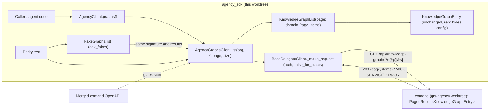

# Application Architecture — paginated knowledge-graph list (SDK)

Part of [design.md](./design.md).

## Narrative

A three-artifact change inside one delegate plus its test double. `AgencyGraphsClient.list` stays a thin
pass-through: it always sends `o`, adds `p`/`s` only when supplied, and applies no defaults or range
checks, because the server owns paging semantics. `KnowledgeGraphList` gains a required
`page: agency_sdk.domain.Page`, making it structurally identical to `PromptPagedResult` and avoiding
both a new type and the duplicate `Page` in `datasets_dto.py`. `KnowledgeGraphEntry` is untouched.
`FakeGraphs` reimplements the server contract (sort by `code`, slice at `p*s`, defaults 0/10, 500
`HTTPError` on negatives, empty items past the end or at `s=0`); a parity test runs identical cases
against the fake and the mocked real client. Errors flow through the existing `_make_request` →
`HTTPError` path. **Precondition for the first task:** the merged gts-agency OpenAPI shows
`params(KgListParams)` and `PagedResult<KnowledgeGraphEntry>` matching handover §2. `Page` is parsed by
field name, not position. Inside `FakeGraphs` the method `list` shadows the builtin, so sort/slice code
uses `sorted(...)`/slicing rather than `list(...)` to stay mypy-clean.

## Diagram

## Decisions

- Keyword-only `page`/`size`; `None` means omit the param, so positional calls keep working and the server owns defaults.
- Reuse `agency_sdk.domain.Page` as a required field: no new pagination type, one canonical paged shape shared with prompts.
- No client-side validation or clamping: a change to server limits needs no SDK release.
- `FakeGraphs` reimplements the server paging semantics, guarded by a fake-vs-mocked-real parity test.
- Coordinated breaking release, gated on the comand deploy and an OpenAPI check against handover §2.

## Risks

- Parity proves fake = mocked client, not fake = server; drift from comand is caught only by the opt-in contract smoke.
- Mocked tests encode the contract as written (`page.size` echo, 500 vs a future 4xx, error-body shape) until the live smoke.
- Hard version coupling: upgrading before the deploy, or not upgrading after it, fails at parse time.
- A comand rollback makes the required `page` fail loudly in consumers; intended, but needs a clear release note.
- With no walk-all helper, callers may stop on `len(items) < size` instead of `total`; the docs example is the mitigation.
