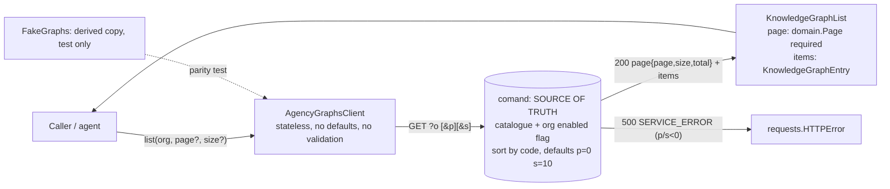

# Data Architecture — paginated knowledge-graph list (SDK)

Part of [design.md](./design.md).

## Narrative

comand is the single source of truth for the catalogue: membership, per-org `enabled`, ordering,
`total` and paging defaults (`p=0`, `s=10`, 0-based, no maximum). The SDK stores, caches and derives
nothing. `KnowledgeGraphList` validates the paged body with `page: Page` required, reused from
`agency_sdk.domain` (the field-identical copy in `datasets_dto.py` must not be imported).

Items are ordered by the unique `code`, so the order is total; offset is `p*s` and `total` counts every
item. There is no cursor or snapshot, so a catalogue change between page fetches can skip or repeat an
item. That is acceptable for a small operator-managed catalogue but is stated in `docs/graphs.md`.
Walkers loop on `page.total`, not on `len(items) < size`, and must also stop on an empty page: at
`size=0` `items` is always empty, so a `total`-only loop never ends. `FakeGraphs` is a derived copy of this contract, held to the real client by the parity test.
Retention: none in the SDK; governance of catalogue data is comand's.

## Diagram

## Decisions

- Server owns ordering, `total` and defaults; the SDK sends no defaults and does no clamping.
- Reuse `agency_sdk.domain.Page`, never the `datasets_dto` duplicate (NFR-01).
- `page` is required with `extra="allow"` kept; a body without it fails validation (deliberate break).
- `KnowledgeGraphEntry` unchanged: `enabled` stays, `repr=False` stays on `config`/`credential_variable_id`.
- `FakeGraphs` builds `domain.Page` via an alias import: `adk_fakes.py:39` imports the `datasets_dto` copy, which `FakeSessions` still needs, and pydantic rejects it for `KnowledgeGraphList.page`.

## Risks

- Offset paging without a snapshot: a concurrent catalogue change can skip or duplicate a `code` mid-walk.
- At `size=0` neither `len(items) < size` nor `p*s < total` terminates; docs and the walk test require `size > 0` or stop on empty `items`.
- `total` is re-read per page and can change mid-walk.
- Fake/server drift — Python vs server collation for `code`, `p*s` overflow 500 not modelled — gives false-green tests.
- Version skew breaks `list()` if the SDK is released before the server deploys; gated by UC-05 / handover §5.6.

## Classification

| Field | Class | Handling |
|---|---|---|
| `code`, `name`, `description` | Internal catalogue metadata | Plain; safe in logs and tests |
| `enabled` | Internal org configuration | Plain |
| `config` | Confidential operator configuration | `repr=False`; never log; synthetic fixtures only |
| `credential_variable_id` | Confidential (reference to a secret) | `repr=False`; never log |
| `page.page`, `page.size`, `page.total` | Internal metadata | Plain |
| Request `o` | Internal tenant id | Sent as-is; no real org ids in docs/tests |
| PHI/PII | None — no patient or person data | A PHI-bearing `config` would be a server defect |
