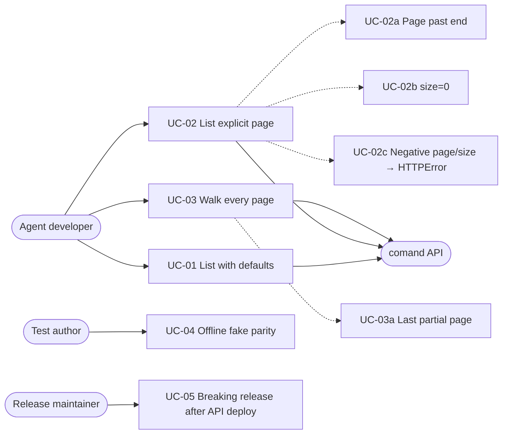
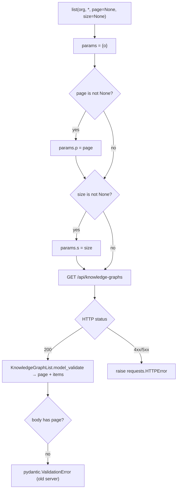
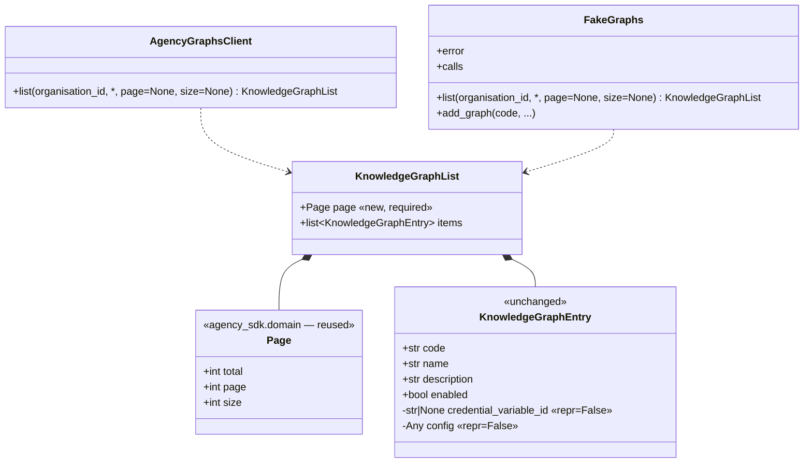

# Design — paginated knowledge-graph list (SDK half)

Inbox item: *Update get knowledge graphs to follow standard pagination*. Source of truth:
[solution-handover.md](../../solution-handover.md) (operator-approved; solution design revision 3).
The comand endpoint, OpenAPI and comand-web are owned by the gts-agency worktree, not this track.

## Overview

`GET /api/knowledge-graphs?o=` moves from `{items}` to the shared paged result
`{page:{page,size,total}, items}` and accepts optional `p`/`s` (0-based, server defaults `p=0`, `s=10`,
no maximum, sorted by `code`). This track makes the SDK match: `AgencyGraphsClient.list` gains
keyword-only `page`/`size`, sent only when given; `KnowledgeGraphList` gains the existing
`agency_sdk.domain.Page`; `FakeGraphs` mirrors the server contract and is held to the real client by a
parity test. No client-side defaults, limits or validation. It ships as a breaking release only after
the paginated API is deployed.

## Actors

- **Agent developer** — calls `client.graphs().list(...)` (e.g. the Sangoma research agent).
- **comand API** — external system serving the paged endpoint (delivered by gts-agency).
- **Test author** — uses `FakeGraphs` offline.
- **Release maintainer** — bumps the version and releases after the API is deployed.

## Use Cases

Acceptance criteria from the inbox note *Acceptance Criteria*: AC-6 → UC-01/UC-02; AC-3 → UC-01;
AC-4 → UC-02b/UC-02c; AC-5 → UC-03; AC-7 (SDK part) → every UC via the test plan. AC-1/AC-2 are the
endpoint's (gts-agency); the SDK sees AC-2 as UC-01's parsed `page` metadata.

- **UC-01** List with server defaults — no `page`/`size`; only `o` sent; `page` metadata parsed.
- **UC-02** List an explicit page — `p`/`s` sent as given; metadata parsed.
  - **UC-02a** Page past the end → 200, `items == []`, real `total`.
  - **UC-02b** `size=0` → 200, `items == []`, `page.size == 0`.
  - **UC-02c** Negative `page`/`size` → request still sent; server 500 → `requests.HTTPError`.
- **UC-03** Walk every page using `page.total` — each `code` exactly once.
  - **UC-03a** Last, partial page.
- **UC-04** Test offline with `FakeGraphs` — same signature and same results/errors as the real client.
- **UC-05** Release a breaking version after the paginated API is deployed (docs, `CHANGE_LOG.md`, version).

Approximation: Mermaid has no use-case diagram; actors are left-hand nodes.

## Activity

## Class

## Component

Not produced: one delegate inside one package; the class and activity diagrams carry the structure,
and the application architecture's container view shows the SDK ↔ comand boundary.

## Architecture

| Domain | Document | In scope |
|---|---|---|
| Business | [business-architecture.md](./business-architecture.md) | Minimal — contract conformance on one read call; no capability or process change |
| Application | [application-architecture.md](./application-architecture.md) | Yes |
| Technical | [technical-architecture.md](./technical-architecture.md) | Minimal — no runtime/infra change; release sequencing only |
| Data | [data-architecture.md](./data-architecture.md) | Yes |
| Security | [security-architecture.md](./security-architecture.md) | Yes |

## Impact Analysis

- `agency_sdk/delegates/graphs_dto.py` — `KnowledgeGraphList.page: Page` (required), docstrings.
- `agency_sdk/delegates/graphs_client.py` — new keyword-only signature, conditional `p`/`s`.
- `agency_sdk/test/adk_fakes.py` — `FakeGraphs` sort/slice/defaults/500 on negatives; builds `domain.Page` via an alias (line 39's `datasets_dto.Page` stays for `FakeSessions`).
- Tests: `test_graphs_client.py`, `test_graphs_dto.py`, `test_adk_fakes_graphs.py` (parity),
  `test_graphs_docs.py`, `test_client_facade.py`; `test_contract_graphs.py` asserts the paged shape.
- `docs/graphs.md`, `CLAUDE.md`, `CHANGE_LOG.md`, `pyproject.toml` version.
- **Breaking:** this SDK cannot parse the old `{items}` body; older SDKs cannot parse the new one.
- No other delegate, DTO or the duplicate `Page` in `datasets_dto.py` changes.

## Open Questions for Refinement

Operator answers (inbox request 01M7RV67H0AGA8KH83MGY6KWXE, 2026-11-18), resolving Q1–Q4 and Q8:
design approved; coordinated breaking release with no fallback, stated in changelog and release notes;
no walk-all helper (possible follow-up only); version `0.0.3rc1`; the live contract smoke is not a CI gate
but a required manual check before publishing, recorded in the track.

Still open for refinement:

1. Does the merged OpenAPI match handover §2 exactly (`page.size` echoes requested size, `s=0` → 200, field names)? Checked at the first task.
2. Will gts-agency add a server `size` cap or turn the negative `p`/`s` 500 into a 4xx later? (SDK asserts 500 for now)
3. Should the fake's 500 carry the `SERVICE_ERROR` envelope body or status only? (pinned by the parity test)
4. Docs wording for offset paging without a snapshot; the walk example stops on `page.total` or empty `items`.
