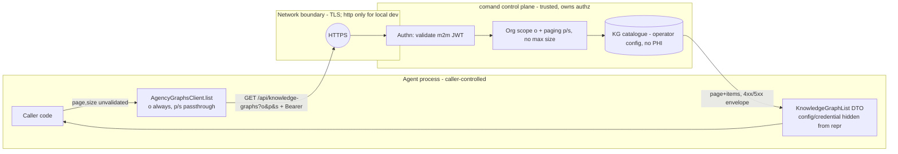

# Security Architecture — paginated knowledge-graph list (SDK)

Part of [design.md](./design.md).

## Narrative

No new endpoint, credential, token path, host or data class. Authentication stays the shared OAuth2
client-credentials bearer, sent only in the `Authorization` header; org scoping stays the mandatory `o`,
always sent. `p`/`s` are passed through unvalidated (approved NFR-01), so comand — owned by the
gts-agency worktree — is the sole enforcement point for authorisation, org scoping and paging limits;
that is an assumption this track cannot verify. `total` counts the built-in catalogue, identical for every
org, so it discloses nothing about other orgs. The catalogue is operator configuration, not PHI;
`config` and `credential_variable_id` stay hidden from `repr`. Tests and docs use synthetic codes, ids
and a canary token. Existing register rows T-004, T-018, T-033, T-034 and T-035 (transport, shared token, token leak via
request headers, catalogue config, `config.base_url`) still apply; this change adds T-2, T-3 and T-7.

## Diagram

## Decisions

- Authn/authz unchanged: bearer in header only, `o` always sent, no new credential path.
- No client-side clamping or validation; the server is the sole enforcement point; residual DoS accepted.
- `page` is non-sensitive and unredacted; `config`/`credential_variable_id` stay hidden from `repr`.
- `FakeGraphs` reproduces the 500 via a synthetic `StubResponse`; no real org data or tokens in fixtures.
- Gate implementation on the merged gts-agency contract; a mismatch means stop, not adapt.

## Risks

- Authz and org scoping are enforced only in comand; the SDK cannot verify them.
- No maximum `size` anywhere: a huge caller-supplied `size` is a self-inflicted resource-exhaustion path.
- Negative `p`/`s` yields a 500 whose exception message carries the URL (org id) to callers that log it.
- Required `page` fails hard against an old server; release order must be strict.
- Bearer protection on the error path remains docs-only (never log `exc.response.request.headers`, T-033).

## Threat Model

Register schema ([SECURITY.md](../../SECURITY.md)). Local T-2, T-3, T-7 are new; the rest update existing register rows.

| ID | STRIDE | Threat | Asset / Boundary | Severity | Likelihood | Status | Mitigation |
|---|---|---|---|---|---|---|---|
| T-1 → T-018 | Elevation of privilege | Manipulated `o` or paging reads another org's entries | `o` param ↔ comand org scoping | Medium | Low | Open | `o` always sent; comand binds token to org (gts-agency); `p`/`s` cannot widen scope |
| T-2 (new) | Denial of service | Huge caller-supplied `size` exhausts server or agent memory | Caller `size` ↔ comand list endpoint | Low | Medium | Accepted | Handover forbids a client or server max; `size` opt-in, no client default; `docs/graphs.md` advises bounded sizes (deliverable, TS-23) |
| T-3 (new) | Tampering | Negative/extreme `p`/`s` passed through triggers a 500 whose message carries the URL (incl. org id) | Caller args ↔ comand error path | Low | Medium | Accepted | Handover forbids client validation; request sent, `HTTPError` surfaced (TS-09/10); SDK logs nothing |
| T-4 → T-033 | Information disclosure | `exc.response.request.headers` on the new error paths leaks the bearer into caller logs | Bearer ↔ exceptions / caller logs | High | Low | Mitigated | Header-only bearer; canary tests rerun with paging args (TS-26); docs-only residual |
| T-5 | Information disclosure | `total`/items reveal other orgs' data | Paged response ↔ caller | Low | Low | Mitigated | `total` counts the built-in catalogue, same for all orgs; `enabled` scoped by comand |
| T-6 → T-034 | Information disclosure | `config`/`credential_variable_id` leak via `repr`, tests or docs | `KnowledgeGraphEntry` ↔ logs/traces | Low | Medium | Mitigated | `repr=False` unchanged; DTO redaction test (TS-16); synthetic fixtures; `model_dump` unredacted |
| T-7 (new) | Tampering | Malformed or missing `page` corrupts a consumer's walk (early stop skips entries) | Response body ↔ consumer paging loop | Low | Low | Mitigated | `page` required and strictly typed (TS-13/14); walk test loops on `page.total` and stops on empty `items` (TS-11/12) |
| T-8 → T-004 | Information disclosure | On-path attacker forges a page or harvests the token | Agent ↔ comand transport | High | Low | Accepted | TLS is a deployment property; no `verify=False` path (TS-33); docs warn against `http://` |

## Compliance

- HIPAA: the catalogue is operator configuration, not PHI; no new PHI egress; no real PHI or org data in tests/docs.
- Access control and audit (164.312(a)/(b)): unchanged; enforced and logged by comand; the SDK adds no logging.
- Transmission security (164.312(e)): unchanged; TLS is a deployment property, verification never disabled.
- Secrets: none new; `credential_variable_id` stays hidden; the token is never persisted.
