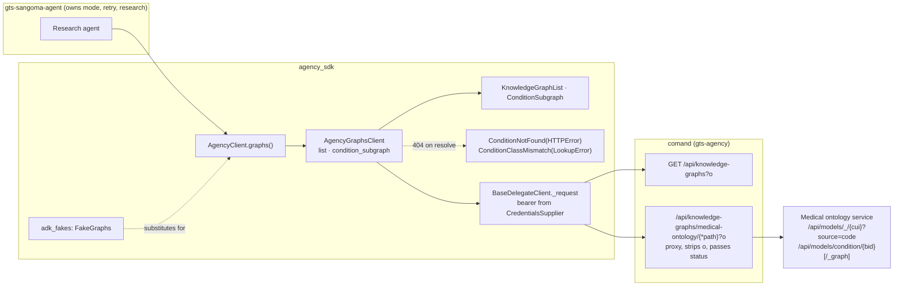

# Application Architecture — Sangoma SDK knowledge-graph list & condition subgraph

Back to [design.md](./design.md).

## Narrative

One new delegate, **`AgencyGraphsClient`** (`delegates/graphs_client.py`, DTOs in `graphs_dto.py`,
`api_path="/api/knowledge-graphs"`), exposes two reads through comand. All mode, retry and research
logic stays in gts-sangoma-agent.

**`list(organisation_id)`** calls `_make_request("GET", "", params={"o": ...})` and returns
`KnowledgeGraphList.model_validate(body)`. The response is the built-in catalogue with per-org
`enabled`, and it is not paged.

**`condition_subgraph(organisation_id, code, *, depth=1, direction="any")`**
- It checks the code with `re.fullmatch(r"[CB][0-9]{7}", code)` (`C`=UMLS CUI, `B`=authored id), plus
  `depth` (int, 1–6) and `direction` (`out`/`in`/`any`).
- It resolves via the existing proxy at `/medical-ontology/api/models/_/{code}?source=code`. comand
  strips `o` and passes the upstream status and body through.
- It catches the `HTTPError` that `_request` raises. Only a 404 whose JSON body is exactly
  `{"detail":"not found"}`, the ontology service's not-found shape, becomes `ConditionNotFound`. Any
  other 404 or error re-raises unchanged.
- A non-`condition` root raises `ConditionClassMismatch`.
- The root `bid` must be UUID-shaped. The walk then calls
  `/medical-ontology/api/models/condition/{bid}/_graph?depth=&direction=` and returns
  `ConditionSubgraph(root, vertices, edges)`, with the root taken from the resolve call because
  `_graph` may omit it.

**`AgencyClient`** gains `graphs_client` and a `graphs()` accessor. **`adk_fakes.py`** gains `FakeGraphs`, with the real signatures, hanging off `FakeControlPlane` as `cp.graphs`.

## Diagram

## Decisions

1. Resolve first, then walk. `_graph` returns an empty 200 for an unknown bid (verified), so only resolve can say *not found*. Both code families resolve through `source=code`, because bids are UUIDs.
2. Only a resolve 404 with body `{"detail":"not found"}` becomes `ConditionNotFound` (`response` kept, fixed message). A misrouted 404 (comand or gateway), a walk error or any other status propagates as `HTTPError`, so *create* is never picked on error.
3. `re.fullmatch` on the code (`[CB][0-9]{7}`) and on the server bid (UUID), `depth` int 1–6, `direction` enum, all before use. The query goes through `params=`.
4. Reads keep the base client's default GET connection retry. Errors still raise after it, so mode safety holds.
5. DTOs mirror the servers: `KnowledgeGraphList.items` is required, and `KnowledgeGraphEntry` hides `config`/`credential_variable_id` from `repr`. `ConditionSubgraph` keeps `root`/`vertices`/`edges` as raw dicts, because the ontology documents are open and unmodelled, like `annotations().get_graph`. All of them and both exceptions are re-exported from `agency_sdk/__init__.py`.

## Risks

1. `source=code` matches only the first legacy code, so a condition known under a secondary code reads as *not found* (design OQ4).
2. A CUI can map to a non-condition entity, so the class check raises rather than researching the wrong thing.
3. Authored `B…` ids may not be in any clinical-model `code` column (design OQ3); the smoke test checks.
4. The fakes could drift from the real contract. Mitigated by signature-parity tests and the UC-04 smoke test.
