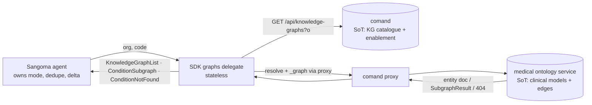

# Data Architecture — Sangoma SDK knowledge-graph list & condition subgraph

Back to [design.md](./design.md).

## Narrative

The SDK is stateless and persists nothing. comand owns the knowledge-graph catalogue and per-org
enablement. The medical ontology service owns clinical-model entities and their
`ClinicalRelationship` edges (`data/knowledge_graph.db`).

**List.** `{items:[{code, name, description, enabled, credential_variable_id?, config?}]}` mirrors
comand's `ListKnowledgeGraphsResponse`. `config` is present whenever the org has an enablement row.
`credential_variable_id` is present when that row also names a credential. `config` is opaque `Any`.

**Condition subgraph.** The root is one entity document: open properties, `bid`, `class` as the
discriminator, a `code` holding the CUI, and provenance fields such as `created`, `created_by` and `sid`.
The walk returns `SubgraphResult {vertices, edges}`. Vertices are entity documents, and edges carry
`from`/`to` bids and `rel`, plus evidence fields on publish-written `uses` edges. The SDK validates only
the structure (`root.bid`, `root.class`, `vertices`/`edges` as lists). The documents stay raw dicts:
the agent, not the SDK, compares them with its delta to find duplicates.

## Diagram

## Decisions

1. Stateless, no cache: the graph grows run by run, so a cached subgraph would mis-dedupe.
2. `ConditionSubgraph` = `root: dict`, `vertices: list[dict]`, `edges: list[dict]` (open documents, `extra="allow"`), with structural validation only.
3. `KnowledgeGraphEntry` mirrors comand. `config: Any | None` and `credential_variable_id` are `repr=False`.
4. *Not found* means a 404 on resolve with the MOS body `{"detail":"not found"}`, nothing else. An empty `vertices` list for an existing root is a found graph with no facts yet.
5. The SDK does no transformation or lineage step. Documents are returned as served.

## Risks

1. Subgraph size grows with `depth` (clamped 1–6 server-side). A deep walk on a hub condition may be large, so the default is depth 1.
2. Document fields vary by class and generation (legacy edges lack evidence keys), so the agent must tolerate absent keys. `source=code` sees only the first legacy code.
3. `config` may carry internal URLs. It is hidden from `repr`, but `model_dump` still returns it.

## Classification

| Element | Class | PHI/PII | Handling |
|---|---|---|---|
| `organisation_id` | Tenant id | No | Query param `o` |
| Condition `code` (`C`/`B` + 7 digits) | Reference terminology | No (a condition, not a person) | `fullmatch`-validated path segment |
| Entity `bid` | Internal id (UUID) | No | UUID-validated before the walk |
| Root/vertex documents, edges | General clinical knowledge + provenance (`created_by` = author or agent id) | No PHI; `created_by` may name an internal user | Returned raw; not logged by the SDK |
| `KnowledgeGraphEntry.config` | Internal config (upstream URLs) | No | Opaque; `repr=False` |
| `credential_variable_id` | Secret *reference* | No | `repr=False`; never dereferenced |
| Bearer token | Secret | n/a | `CredentialsSupplier` only, never in a DTO, `repr`, exception, log or fixture |
