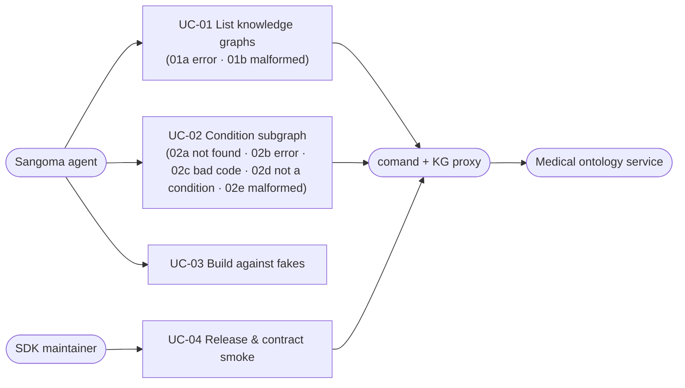
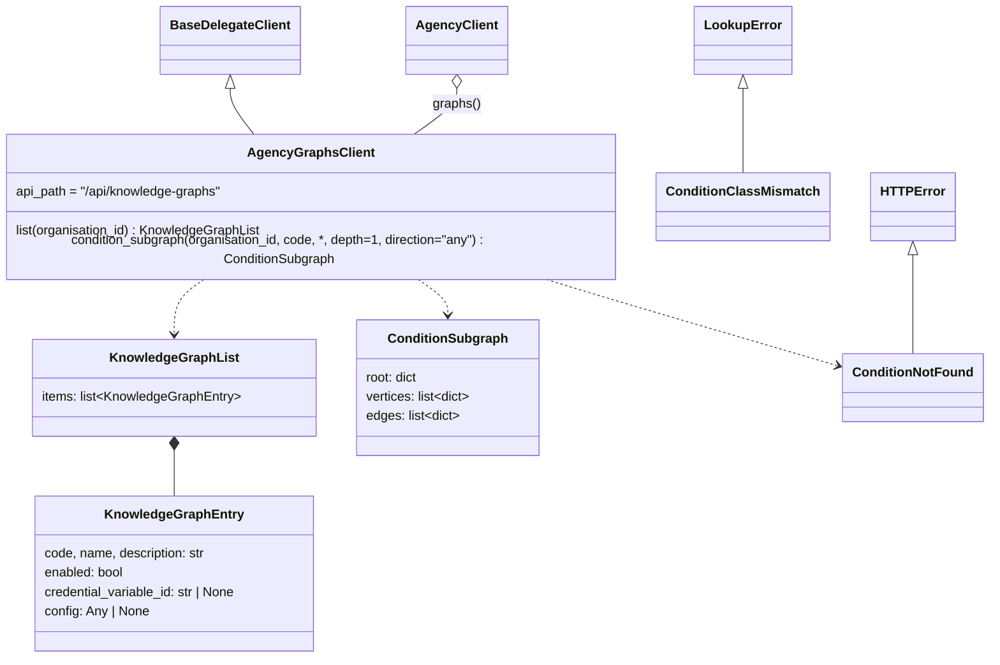

# Design — Sangoma SDK knowledge-graph list & condition subgraph

Inbox item: **Sangoma Condition Researcher** (this worktree's portion: `gts-agency_python-sdk`).
Governing instruction: the [solution handover](../../solution-handover.md) (sha256 `56e2dba9…`), **as amended
by the operator on 2026-11-14**:
- G1/C5 `_find` discovery is removed.
- Knowledge graphs are listed through the existing `GET /api/knowledge-graphs?o=`.
- A condition is queried by its code (`C…` UMLS CUI or `B…` authored id) through the ontology service's **models
  endpoints**, reached via comand's medical-ontology proxy. The result is the known subgraph, or an error
  when none exists.
- The G2 create-only upload requirement is **dropped**: filenames are always timestamped.
- The agent's service account has the comand access it needs.

## Overview

The Sangoma research agent (gts-sangoma-agent) is given a condition code. Before it researches, it
needs the condition's known subgraph, or proof that the knowledge graph has no such condition, which
selects *create* mode. This track adds two typed reads through comand:
- `graphs().list(org)` returns the org's knowledge-graph catalogue.
- `graphs().condition_subgraph(org, code)` returns the condition entity and its subgraph from
  `/api/models/*`, or raises `ConditionNotFound`.

Both get offline fakes. Not in scope: the agent, the ontology service, comand changes, file
upload changes, retries and mode logic.

## Actors

- **Sangoma agent** — gts-sangoma-agent (`agency.py`), the SDK consumer.
- **comand** — gts-agency Control Plane: `GET /api/knowledge-graphs` and the `/api/knowledge-graphs/medical-ontology/{*path}` proxy (both exist today).
- **Medical ontology service** — serves `/api/models/*` behind the proxy. The SDK never calls it directly.
- **SDK maintainer** — cuts the pre-release, runs the contract smoke test, releases.

## Use Cases

- **UC-01 List the org's knowledge graphs** — `graphs().list(org)` calls `GET /api/knowledge-graphs?o=` and returns `KnowledgeGraphList(items=[KnowledgeGraphEntry(...)])` exactly as comand reports it.
  - **UC-01a Server or transport error** — 401/403/5xx/timeout propagate as `requests` exceptions.
  - **UC-01b Malformed body** — non-object, or `items` missing or not a list, raises a validation error.
- **UC-02 Get a condition's known subgraph** — `graphs().condition_subgraph(org, code, *, depth=1, direction="any")`:
  1. **Resolve.** Both `C…` (UMLS CUI) and `B…` (authored, CUI-shaped) codes call `GET …/medical-ontology/api/models/_/{code}?source=code`, which returns the root entity. A `bid` is a UUID, not a `B…` code, so there is no bid branch.
  2. **Walk.** `GET …/medical-ontology/api/models/condition/{root.bid}/_graph?depth=&direction=` returns the subgraph. The default `any` includes inbound edges such as Medication -treats-> Condition.

  The result is `ConditionSubgraph(root, vertices, edges)`.
  - **UC-02a Not in the knowledge graph** — resolve returns 404 **with the ontology service's body `{"detail":"not found"}`**, which raises `ConditionNotFound` (an `HTTPError`, `response` kept). This is the **only** signal for *create* mode.
  - **UC-02b Server, transport or routing error** — any other status, a 404 with any other body (comand or gateway misroute), or a timeout on either call propagates as `HTTPError`. It is never `ConditionNotFound`.
  - **UC-02c Invalid input** — a code that does not fully match `^[CB][0-9]{7}$` (`re.fullmatch`), a `depth` outside 1–6 or a non-int, or an unknown `direction` raises `ValueError` before any request.
  - **UC-02d Not a condition** — a resolved root whose `class` is not `condition` raises `ConditionClassMismatch`, and the walk is never called. This is not *not found*: the agent must stop, not create.
  - **UC-02e Malformed body** — a root without `class` or without a UUID-shaped `bid`, or a subgraph without `vertices`/`edges` lists, raises a validation error.
  - **Known limit** — `source=code` matches only an entity's first legacy code (MOS D7). A condition known under a secondary code can 404, so the agent owns any extra confirmation before it creates.
- **UC-03 Build against fakes** — the agent's offline tests drive `list` and `condition_subgraph`, including not-found and mismatch, via `agency_sdk/test/adk_fakes.py`.
- **UC-04 Release** — pre-release for the agent to pin, then contract smoke against non-production comand (list, plus subgraph for a known and an unknown code), then release and changelog.

Cross-cutting (NFR-01): the bearer token never appears in any exception message, `repr`, log or DTO.



## Activity

```mermaid
flowchart TD
  S[condition_subgraph org, code] --> V{code fullmatches ^[CB][0-9]{7}$?}
  V -- no --> E0[ValueError, no request]
  V -- yes --> R1[GET …/api/models/_/code?source=code]
  R1 --> D{status}
  D -- 404 + detail=not found --> NF[raise ConditionNotFound → agent: create]
  D -- other error / other 404 / timeout --> E1[raise HTTPError]
  D -- 200 --> C{root valid and class == condition?}
  C -- malformed --> E2[raise ValidationError]
  C -- other class --> E3[raise ConditionClassMismatch]
  C -- yes --> W[GET …/api/models/condition/bid/_graph?depth&direction]
  W -- error / timeout --> E1
  W -- 200 --> M{vertices and edges lists?}
  M -- no --> E2
  M -- yes --> OK[return ConditionSubgraph → agent: add basic facts]
```

## Class



## Component

Not produced. This is one delegate inside one existing library, and the application diagram already covers SDK → comand proxy → ontology service.

## Architecture

| Domain | Document | In scope |
|---|---|---|
| Business | [business-architecture.md](./business-architecture.md) | Minimal — no process change (reason in doc) |
| Application | [application-architecture.md](./application-architecture.md) | Yes |
| Technical | [technical-architecture.md](./technical-architecture.md) | Minimal — no infra change (reason in doc) |
| Data | [data-architecture.md](./data-architecture.md) | Yes |
| Security | [security-architecture.md](./security-architecture.md) | Yes |

## Impact Analysis

- New: `delegates/graphs_client.py`, `delegates/graphs_dto.py`, and `AgencyClient.graphs()`.
- New exceptions: `ConditionNotFound(HTTPError)` and `ConditionClassMismatch(LookupError)`.
- Root exports: these exceptions plus the graph DTOs, re-exported from `agency_sdk/__init__.py` (handover §5.3).
- Fakes: `adk_fakes.py` gains `FakeGraphs` (list plus seeded condition subgraphs).
- Docs: the `CLAUDE.md` delegate list (→ thirteen delegates; it said eleven, but the facade already composed twelve), a graphs doc, and `CHANGE_LOG.md` at release.
- No change to `files_client.py`, `CredentialsSupplier`, the base client or the other delegates.
- No new server dependency: both endpoints exist in comand today.
- Removed versus the handover: `find`/`GraphLookup` (G1/C5) and `upload(create_only)`/`FileExistsConflict` (G2/C6).

## Open Questions for Refinement

1. Closed: comand's proxy joins `config.base_url` (the service root) with `api/models/...`, confirmed in code. A non-root `base_url` would surface as a non-MOS 404, i.e. `HTTPError`, not *not found*.
2. Closed: `_graph` on an unknown bid returns 200 with empty lists, so resolve-first is required.
3. Are authored `B…` ids stored in a clinical-model `code` column, so that `source=code` finds them? `mint_authored_id` writes `GtsConcept.cui`. Verify with an operator-supplied `B…` condition in the smoke test. (`B` ids widen past `B9999999`; the regex covers today's 7 digits.)
4. Secondary-code false negatives (the known limit): should the agent confirm via the taxonomy/concept route before creating?
5. Is the default walk (`depth=1`, `direction=any`) right for dedupe? The server clamps depth to 1–6.
6. comand's `{*path}` proxy does not validate segments, so raw callers may traverse upstream. Raise this with the gts-agency owners (security TM-9).
7. Can `config` carry secret material? Should comand hide `config`/`credential_variable_id` from read-only callers?
8. Does G3 add `OntologySnapshot` fields? There is no DTO change until it is confirmed.
