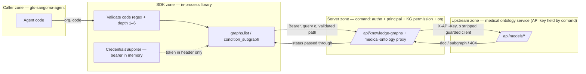

# Security Architecture — Sangoma SDK knowledge-graph list & condition subgraph

Back to [design.md](./design.md).

## Narrative

This slice adds no trust boundary and no credential. Both reads reuse the existing
`CredentialsSupplier` bearer, unchanged, and go only to comand. comand enforces authorization
(`require_principal` plus `KnowledgeGraph` permission in org `o`). comand holds the ontology service's
API key and injects it on the proxy hop, so the SDK never sees it. Four controls matter:

- **Path safety.** The condition code becomes a URL path segment on a proxy that forwards `{*path}`
  upstream. It is checked with `re.fullmatch(r"[CB][0-9]{7}")` before any I/O, so no `/`, `..`, `?`, `%`
  or trailing newline is possible. The bid the server returns must fullmatch a UUID before the walk.
- **Fail-closed not-found, at runtime.** Only a resolve 404 whose body is the ontology service's
  `{"detail":"not found"}` raises `ConditionNotFound`. A misrouted 404 from comand or a gateway,
  and every other status or timeout, propagates. An error never makes the agent pick *create*.
- **Secret hygiene.** The token travels only in the Authorization header, and `ConditionNotFound`
  uses a fixed message. Other errors may carry the URL (`o`, the code) or a body fragment. That
  content is accepted as non-PHI.
- **Catalogue sensitivity.** `config` and `credential_variable_id` are `repr=False` and never dereferenced.

TLS remains the caller's `base_url` choice, which is unchanged.

## Diagram

## Decisions

1. Authentication is unchanged. The token stays out of errors by construction: header-only use, fixed-message exceptions, no new `__repr__` touching the supplier.
2. Authorization and the upstream API key are comand's. The SDK forwards `o` unmodified and never caches across orgs.
3. `fullmatch` on the code and the server bid, `depth` int 1–6 and a `direction` enum mean nothing caller- or server-controlled reaches the proxy path unvalidated.
4. Only a resolve 404 with the MOS not-found body maps to `ConditionNotFound`. Redirects are left at the `requests` default: comand forwards an upstream 3xx, and `requests` drops `Authorization` on a cross-host hop. Residual Low, accepted, and the base client is unchanged.
5. A canary-token test asserts the token's absence from `str`/`repr`/`args` of every raised exception and from DTO `repr`/`model_dump`.

## Risks

1. A secondary-code condition reads as *not found* (MOS first-legacy-code limit). The agent owns any confirmation before it creates.
2. `exc.response.request.headers` carries the bearer. A caller that logs it leaks the token, so docs must warn.
3. No https enforcement: an `http://` `base_url` sends the bearer in clear (existing behaviour).
4. `config.base_url` must never become a bearer destination for the agent (cf. T-011/T-012). The docs say so.

## Threat Model

Columns match the [register](../../SECURITY.md) for close-out. Severity/Likelihood: H/M/L.

| ID | STRIDE | Threat | Asset / Boundary | Severity | Likelihood | Status | Mitigation | Register |
|---|---|---|---|---|---|---|---|---|
| TM-1 | Information disclosure | Bearer leaks via exception, `repr`, log or DTO | Bearer ↔ comand KG endpoints | H | L | Mitigated (graphs paths; token-endpoint errors unchanged per handover §4) | Header-only token; canary test on real `requests.Response` errors | New row; note on T-018 (more endpoints take the shared token) |
| TM-2 | Information disclosure | Upstream `config` URLs / credential variable ids logged by a caller | KG catalogue DTO | L | M | Mitigated | `Field(repr=False)`; no SDK logging; docs warning | New |
| TM-3 | Tampering | Error or misroute read as *not found* → wrong *create* mode, duplicating the graph | Agent mode selection | H | L | Mitigated (runtime body check; secondary-code limit is the agent's) | Only resolve 404 + `{"detail":"not found"}` → `ConditionNotFound`; all else raises; smoke resolves a known code | New |
| TM-4 | Tampering | Path traversal or upstream path smuggling via `code`/bid through the `{*path}` proxy | SDK → comand proxy → MOS | H | L | Mitigated | `fullmatch` on code (`[CB][0-9]{7}`) and server bid (UUID); `depth` int 1–6; `direction` enum; query via `params=` | New |
| TM-5 | Spoofing | Malicious or mis-set upstream returns a forged subgraph | MOS response | M | L | Accepted (comand dependency) | comand's guarded client (allow-listed egress; it does not *follow* redirects, though it forwards an upstream 3xx to the SDK); SDK validates structure only | New |
| TM-6 | Information disclosure | Bearer read on-path when `base_url` is `http://` | Agent ↔ comand transport | H | L | Accepted | Caller uses https; short-lived tokens | Updates T-004 |
| TM-7 | Elevation of privilege | Cross-org read via a different `o` | comand org scoping | H | L | Mitigated (comand) | Principal + permission check server-side; SDK forwards `o` unmodified | New row (comand dependency) |
| TM-8 | Denial of service | Large subgraph or hang | SDK calls | L | L | Mitigated | Default depth 1, max 6; 30 s timeouts; GET-only connection retry | New |
| TM-9 | Elevation of privilege | Raw (non-SDK) caller sends `..%2F` through comand's `{*path}` proxy to reach other upstream paths with comand's API key | comand proxy ↔ MOS | M | L | Open (comand dependency; raised with gts-agency) | Out of SDK reach; the SDK's own paths are validated | New |

## Compliance

HIPAA is not triggered. The payloads are a knowledge-graph catalogue and general clinical knowledge
(conditions, relations and provenance), none of which identifies a patient. `created_by` may name an
internal author: that is workforce data, not PHI. Watch point: if patient-derived content were ever
published into the knowledge graph, the PHI rules would apply. The SDK cannot detect this. Audit
logging is comand's, and the SDK logs nothing new.
