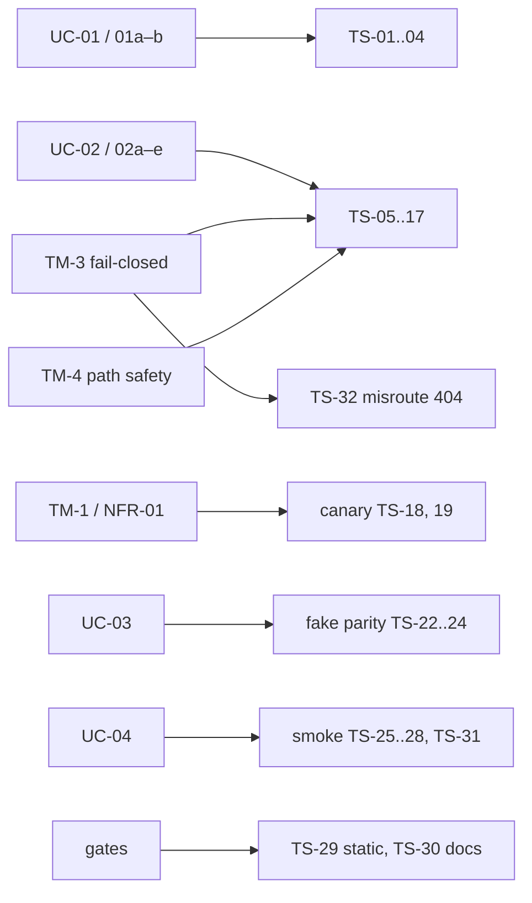

# Test Plan — Sangoma SDK knowledge-graph list & condition subgraph

Back to [design.md](./design.md).

## Strategy

All behaviour except UC-04 is proven offline with the existing `requests` monkeypatch stub
(`conftest.py`). No new tooling is added. Unit tests assert the exact wire request (method, URL path,
params, headers), because both reads are wire-contract claims and the code becomes a proxy path segment.
The heaviest coverage goes to fail-closed not-found (TM-3), path safety (TM-4) and token secrecy (TM-1).
Fake-parity tests stop the fakes drifting. UC-04 is an opt-in `@pytest.mark.integration` smoke test
against non-production comand. It is the only check that can prove the proxy routing (TM-3 misroute)
and record `_graph`'s unknown-bid behaviour. Not proven here: cross-org enforcement and https, which
belong to comand and the caller.

**Fixed expectations:**
- Reads use the default GET connection retry.
- `depth` defaults to 1, `direction` to `any`.
- *Not found* requires the MOS body `{"detail":"not found"}`.
- The `ValueError` for a bad code lists the expected format without echoing the input.

## Test Levels

| Level | Scope | Tooling | Where it runs |
|---|---|---|---|
| Unit (offline) | `AgencyGraphsClient`, graph DTOs, both exceptions, canary | pytest + `stub_requests`, mypy strict, black | local + CI, default `pytest` |
| Fake parity (offline) | `FakeGraphs` vs real signatures/errors | pytest, `inspect.signature` | local + CI |
| Contract smoke (opt-in) | Real `list` and `condition_subgraph` via comand | `pytest -m integration` (marker description widened to non-prod comand) | maintainer → non-prod comand |
| Static / quality gates | mypy strict, black, coverage >80% on new code | mypy, black, pytest-cov | local + CI |
| Review | Docs warnings, `CLAUDE.md`/`CHANGE_LOG.md` | PR review + grep test | PR |

## Scenarios

| TS | Covers | Level | Pri | Given / When / Then | Evidence |
|---|---|---|---|---|---|
| TS-01 | UC-01 | Unit | P1 | 200 `{items:[…]}` incl. an entry without optionals / `list(org)` / typed list, missing optionals `None` | `test_graphs_client.py::test_list_returns_items` |
| TS-02 | UC-01, TM-7 | Unit | P1 | same / inspect request / GET `/api/knowledge-graphs`, params exactly `{"o": "<org>"}`, bearer header | `::test_list_wire` |
| TS-03 | UC-01a | Unit | P1 | 401/403/500, and `ConnectionError`/`ReadTimeout` via custom monkeypatch / `list` / `HTTPError` or the transport error propagates (3 calls / 1 call) | `::test_list_errors_raise` |
| TS-04 | UC-01b | Unit | P1 | parametrised: list / `null` (`content_bytes=b"null"`) / `{}` / `items` not a list / entry missing `code` / pydantic `ValidationError` per shape, nothing returned (`items` required) | `::test_list_malformed_raises` |
| TS-05 | UC-02 | Unit | P1 | `C0000001`: resolve 200 `{bid:<uuid>,class:"condition"}`, walk 200 `{vertices,edges}` / `condition_subgraph` / `ConditionSubgraph` with root from resolve, vertices/edges from walk | `::test_subgraph_cui_found` |
| TS-06 | UC-02, TM-4 | Unit | P1 | same / inspect both requests / GET `…/medical-ontology/api/models/_/C0000001` params `{o, source:"code"}`, then `…/api/models/condition/<uuid>/_graph` params `{o, depth:"1", direction:"any"}` | `::test_subgraph_cui_wire` |
| TS-07 | UC-02 | Unit | P1 | `B0000001` / resolve GET `…/api/models/_/B0000001` params `{o, source:"code"}` (same path as CUIs), then walk / found | `::test_subgraph_b_code_wire` |
| TS-08 | UC-02 | Unit | P2 | `depth=3`, `direction="in"` / walk params `depth:"3"`, `direction:"in"`; `depth` 0, 7, `"2"`, `True`, or `direction="up"` / `ValueError`, zero requests | `::test_subgraph_depth` |
| TS-09 | UC-02a, TM-3 | Unit | P1 | resolve 404 body `{"detail":"not found"}` / `ConditionNotFound` (is `HTTPError`, `.response.status_code==404`), walk never called | `::test_subgraph_not_found` |
| TS-10 | UC-02b, TM-3 | Unit | P1 | resolve 401/403/500/502 / plain `HTTPError`, never `ConditionNotFound` | `::test_subgraph_resolve_errors_not_not_found` |
| TS-11 | UC-02b, TM-3 | Unit | P1 | resolve 200, walk 404 / 500 / plain `HTTPError`, never `ConditionNotFound` | `::test_subgraph_walk_errors` |
| TS-12 | UC-02b, TM-8 | Unit | P2 | `ConnectionError`/`ReadTimeout` injected on resolve, then separately on walk (`time.sleep` patched) / propagates (3 calls / 1 call per step), never `ConditionNotFound`; timeout 30 s | `::test_subgraph_transport_errors` |
| TS-13 | UC-02c, TM-4 | Unit | P1 | codes `""`, `"X1234567"`, `"C123/../"`, `"C1234567\n"`, `"C123456?"`, `"C12%2F45"`, `"c1234567"`, `"C123456"`, `"C12345678"` / `ValueError`, zero requests, message omits input | `::test_subgraph_invalid_code` |
| TS-14 | UC-02e, TM-4 | Unit | P1 | resolve returns `bid` `"x/../y"`, `"B0000001"`, or a UUID + `"\n"` / raises before the walk, zero walk requests | `::test_subgraph_rejects_unsafe_server_bid` |
| TS-15 | UC-02d | Unit | P1 | resolve 200 `{bid, class:"medication"}` / `ConditionClassMismatch`, walk never called | `::test_subgraph_class_mismatch` |
| TS-16 | UC-02e | Unit | P1 | parametrised: resolve missing `bid` / missing `class` / non-object → pydantic `ValidationError`, zero walk requests; walk missing `vertices` / `edges` not a list → `ValidationError`; nothing returned | `::test_subgraph_malformed` |
| TS-17 | UC-02, Data dec. 4 | Unit | P2 | resolve 200, walk 200 `{vertices:[], edges:[]}` / found with no facts (not *not found*); a legacy edge without evidence keys parses | `::test_subgraph_empty_edges_is_found` |
| TS-18 | NFR-01, TM-1 | Unit | P1 | canary bearer on real `requests.Response` (url + `PreparedRequest`) / every failing `list`/`condition_subgraph` path / absent from exception `str`/`repr`/`args`, DTO `repr`/`model_dump` | `::test_canary_token_absent` |
| TS-19 | NFR-01, TM-1 | Unit | P2 | canary / success paths / only in the `Authorization` header | `::test_token_only_in_header` |
| TS-20 | TM-2 | Unit | P2 | entry with canary `config.base_url`, `credential_variable_id` / `repr` / neither appears; attributes readable | `test_graphs_dto.py::test_repr_hides_config` |
| TS-21 | UC-01, UC-02 | Unit | P2 | `AgencyClient.graphs()`; `from agency_sdk import …` the DTOs and exceptions / delegate shares supplier; identities match | `test_client_facade.py::test_graphs_accessor_and_root_exports` |
| TS-22 | UC-03 | Fake parity | P1 | `FakeGraphs.list`/`condition_subgraph` / `inspect.signature` equal to real | `test_adk_fakes_graphs.py::test_fake_signatures_match_real` |
| TS-23 | UC-03, UC-02a, UC-02d | Fake parity | P1 | `add_graph`, `add_condition(code, root, vertices, edges)` seeded / found; unseeded → `ConditionNotFound`; non-condition root → `ConditionClassMismatch`; bad code → `ValueError` | `::test_fake_condition_subgraph` |
| TS-24 | UC-03, UC-01a, UC-02b | Fake parity | P2 | injected `http_error(500)` / both fakes raise `HTTPError` | `::test_fake_error_injection` |
| TS-25 | UC-04, TM-3 | Integration | P1 | non-prod comand, env service account, operator-provided known `C…` condition / `condition_subgraph` / found, root `class=="condition"` (proves proxy routing) | `test_contract_graphs.py::test_known_condition` |
| TS-26 | UC-04, UC-02a | Integration | P1 | a syntactically valid unknown code (`C9999999`) / `ConditionNotFound` | `::test_unknown_condition` |
| TS-27 | UC-04, UC-01 | Integration | P1 | real `list(org)` / parsed; `medical-ontology` present and enabled | `::test_list_contract` |
| TS-28 | UC-04, TM-3 | Integration | P1 | unknown `C9999999` via the raw proxy / body is exactly `{"detail":"not found"}` (pins the TS-09 contract) | `::test_mos_not_found_body_contract` |
| TS-29 | Quality gate | Static | P1 | release candidate / mypy, `black --check`, `pytest --cov` / clean, >80% new code | CI log |
| TS-30 | TM-2, TM-6, Sec risks 2–4 | Review + Unit | P2 | docs / grep test finds warnings: logging `request.headers`/`config`, `http://` base_url, never send the token to `config.base_url` | `test_adk_docs.py`-style grep test |
| TS-31 | UC-04, design OQ3 | Integration | P1 | operator-provided authored `B…` condition / `condition_subgraph` / found (a MOS 404 here means OQ3 is false; amend the design before release) | `test_contract_graphs.py::test_authored_b_code` |
| TS-32 | UC-02b, TM-3 | Unit | P1 | resolve 404 with empty body, HTML, `{"error":…}` or `{"detail":"other"}` (misroute) / plain `HTTPError`, never `ConditionNotFound` | `test_graphs_client.py::test_subgraph_non_mos_404_is_error` |

## Traceability

| Item | Scenarios |
|---|---|
| UC-01 | TS-01, TS-02, TS-21, TS-27 |
| UC-01a | TS-03, TS-24 |
| UC-01b | TS-04 |
| UC-02 | TS-05, TS-06, TS-07, TS-08, TS-17, TS-21, TS-25 |
| UC-02a | TS-09, TS-23, TS-26, TS-28 |
| UC-02b | TS-10, TS-11, TS-12, TS-24, TS-32 |
| UC-02c | TS-13 |
| UC-02d | TS-15, TS-23 |
| UC-02e | TS-14, TS-16 |
| UC-03 | TS-22, TS-23, TS-24 |
| UC-04 | TS-25, TS-26, TS-27, TS-28, TS-31 (gates: TS-29, TS-30) |
| NFR-01 | TS-18, TS-19 |
| TM-1 | TS-18, TS-19, TS-30 |
| TM-2 | TS-20, TS-30 |
| TM-3 | TS-09, TS-10, TS-11, TS-28, TS-32 |
| TM-4 | TS-06, TS-13, TS-14 |
| TM-5 | no scenario: accepted comand dependency (guarded client) |
| TM-6 | TS-30 (docs; enforcement out of scope) |
| TM-7 | comand-owned; TS-02 asserts `o` forwarded unmodified |
| TM-8 | TS-08, TS-12 |
| TM-9 | no scenario: comand-owned, raised with gts-agency |
| App risks 1–4 | known limit (design OQ4), TS-15, TS-31, TS-22 |
| Data risks 1–3 | TS-08, TS-17, TS-20 |
| Sec risks 1–4 | known limit (design OQ4), TS-30, TS-30, TS-30 |

## Test Data & Environments

- Synthetic codes (`C0000001`, `B0000001`, `C9999999`), synthetic UUID bids and synthetic documents only. No patient data.
- Unit/fake tests use only the canary `CANARY-TOKEN-NOT-REAL` via a custom stub supplier. The smoke test uses a dedicated non-prod service account from env, never a production, personal or pasted browser token, and never in a fixture, log or report.
- The smoke's known `C…` and authored `B…` conditions come from the operator via env. A missing value **fails** the run rather than skipping it. The new smoke tests get their own comand probe, separate from the Agent Vault probe.
- Graph-entry `config` uses `https://example.invalid`.
- The attached smoke report must not echo credentials, `config` or subgraph documents.
- Unit/fake tests need no network. The smoke test needs non-prod comand only.
- The smoke run skips when the probe fails, but a skip never satisfies the exit criteria.

## Entry & Exit Criteria

- Entry: the Strategy section states the fixed expectations.
- Entry: the operator supplies a known `C…` condition and an authored `B…` condition for TS-25/TS-31.
- Exit: TS-01–TS-24 and TS-32 pass offline with no network access, and the TS-29/TS-30 gates pass.
- Exit: >80% coverage on `graphs_client.py`, `graphs_dto.py` and the `FakeGraphs` code.
- Exit: `mypy agency_sdk/` and `black --check agency_sdk/` clean.
- Exit: the existing suite passes unmodified.
- Exit: TS-25–TS-28 and TS-31 **pass (not skip)** once against non-prod, with the pytest report in the release notes. Until then, the release is blocked.
- Exit: the docs (TS-30), `CLAUDE.md` and `CHANGE_LOG.md` updates are in the diff.

## Coverage Map

## Open Questions

1. Which known `C…` condition and which authored `B…` condition seed TS-25/TS-31?
2. Are authored `B…` ids reachable via `source=code` (TS-31)?
3. Secondary-code false negatives (design OQ4): does the agent confirm before creating?
