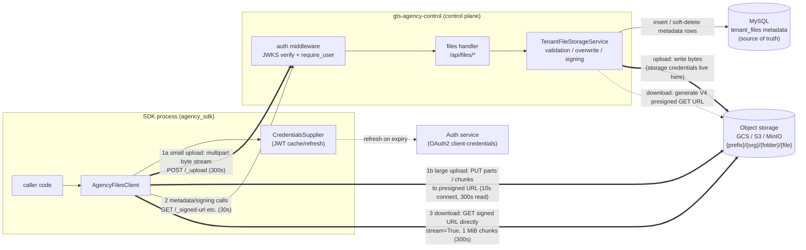
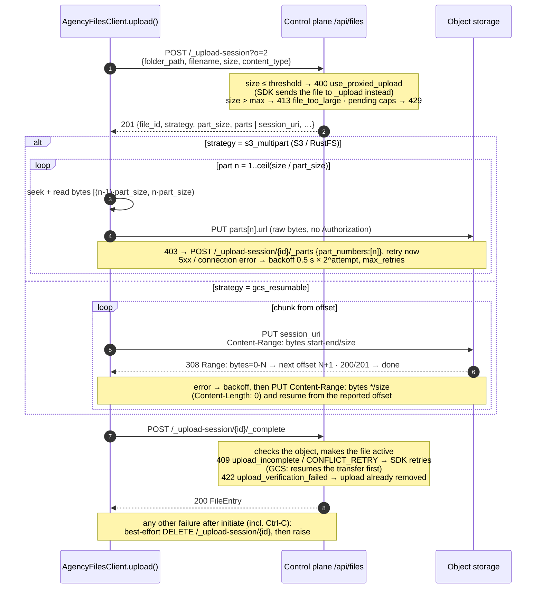
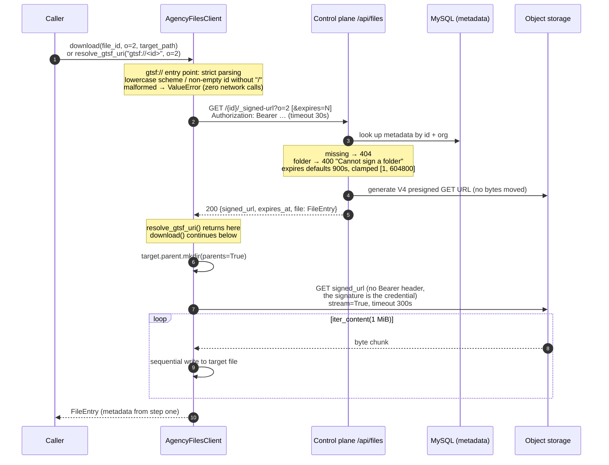

# File Storage Flows: Upload / Download Architecture

Covers the `AgencyFilesClient` implementation
(`agency_sdk/delegates/files_client.py`) for
[issue #1](https://github.com/groundtruthsystems/gts-agency_python-sdk/issues/1).
Server-side counterpart: `gts-agency-control/src/handler/files.rs` and
`service/tenant_files/`.

Core design:

- **Upload routes by size.** `upload()` reads the limits from `GET /api/files/_limits`
  once per call:
  - Files at or under `proxied_upload_max_bytes` (1 MiB by default, configurable up to
    30 MiB) pass **through** the control plane (relay style, `POST /_upload`), batched so
    each request stays within that threshold.
  - Larger files, up to `max_upload_bytes` (5 GiB by default), use an **upload session**:
    the control plane hands out presigned S3 part URLs or a GCS resumable session URI, the
    SDK sends the bytes **straight to the bucket**, and `_complete` verifies the object
    and makes the file active.
- **Download**: bytes **bypass** the control plane (presigned direct-to-storage) —
  the control plane only issues a short-lived signed URL; object storage carries
  the bandwidth.

## Component Architecture



> Thick edges are **byte paths**; thin edges are **metadata/control paths**.
> Storage credentials exist only on the control plane; the SDK only ever holds
> time-limited signed URLs (downloads, default 15 minutes) and upload-session URLs.
> Those URLs are credentials: the SDK never puts them in exception messages, logs or
> `repr`.

## Upload Flow: proxied (files at or under the threshold)

`client.upload(organisation_id, file_paths, path)` for small files — byte path:
local disk → SDK process memory → HTTP request body → control plane memory →
object storage.

```mermaid
sequenceDiagram
    autonumber
    participant APP as Caller
    participant SDK as AgencyFilesClient.upload()
    participant IDP as Auth service
    participant CP as Control plane /api/files/_upload
    participant DB as MySQL (metadata)
    participant OS as Object storage

    APP->>SDK: upload(o=2, [a.pdf, b.txt], path="guidelines")
    Note over SDK: empty list, missing file or not a regular file → ValueError<br/>(no network call)
    SDK->>CP: GET /_limits?o=2
    CP-->>SDK: {proxied_upload_max_bytes, max_upload_bytes, part_size}
    Note over SDK: file > max_upload_bytes → ValueError (no write)<br/>group files ≤ threshold into batches, total ≤ threshold
    SDK->>IDP: only when cached JWT expired:<br/>client-credentials exchange
    IDP-->>SDK: access_token
    Note over SDK: ExitStack opens handles<br/>mimetypes guesses content type by extension<br/>builds multipart: repeated "file" fields
    SDK->>CP: POST /_upload?o=2&path=guidelines<br/>Authorization: Bearer …<br/>Content-Type: multipart/form-data; boundary=…<br/>(timeout 300s)
    Note over CP: body ≤ threshold + 1 MiB framing<br/>(else 413 use_signed_upload)<br/>JWKS signature + audience + require_user
    loop each multipart field
        Note over CP: field name ≠ "file" → silently ignored<br/>missing filename or contains / \ .. → 400<br/>file over the threshold → 413 use_signed_upload
        CP->>DB: active row with same name in folder?<br/>→ soft-delete old row (overwrite semantics)
        CP->>OS: save_object_from_bytes<br/>key: {prefix}/{org}/{folder}/{filename}
        CP->>DB: insert new metadata row<br/>(id, size_bytes, content_type, uploaded_by…)
    end
    CP-->>SDK: 200 {"uploaded": [FileEntry…]}
    SDK-->>APP: UploadResult (Pydantic)
```

If `_limits` cannot be fetched, the SDK sends each file to `_upload` on its own and
moves it to an upload session when comand answers `413 use_signed_upload`.

## Upload Flow: upload session (files over the threshold)

One session per file, in `file_paths` order. Byte path: local disk → one part in SDK
memory → object storage, **never through the control plane**.



The first unrecoverable failure stops `upload()` with `FilesUploadError` (a
`requests.HTTPError`). Its `uploaded` lists the files that already succeeded; uploads
overwrite by name, so retrying the call is safe.

## Download Flow (presigned direct, two steps)

`client.download(file_id, organisation_id, target_path)` — byte path:
object storage → SDK process (1 MiB chunks) → local disk; **never through the
control plane**.



## Constraint Quick Reference

| Constraint | Value | Enforced by |
|---|---|---|
| Proxied threshold (`proxied_upload_max_bytes`) | 1 MiB default, up to 30 MiB; read from `GET /_limits` | server (413 `use_signed_upload`) |
| Proxied request body cap | threshold + 1 MiB of multipart framing; the SDK batches within the threshold | server (413) |
| Per-file maximum (`max_upload_bytes`) | 5 GiB default | SDK (`ValueError`, before any write) and server (413 `file_too_large`) |
| Session part size | 64 MiB default; GCS chunks are multiples of 256 KiB | server |
| Multipart field name | must be `file`; other names **silently ignored** | server |
| File/folder names | non-empty; no `/`, `\`, `..` | server (400) |
| Same-name upload | overwrite: old row soft-deleted, object key reused | server |
| Signed URL lifetime | default 900s, clamped [1, 604800] | server |
| Upload/download timeout | 300s (metadata/signing/session calls 30s; direct PUTs 10s connect, 300s read) | SDK |
| Upload retries | `max_retries=3`, backoff `retry_base_delay=0.5` s doubling (constructor kwargs) | SDK |
| Download memory peak | ≈1 MiB (streamed chunks) | SDK |
| Upload memory peak | proxied: ≈ 2 × batch size (2 MiB at the default threshold); session: ≈ one `part_size` | SDK |
| `gtsf://` parsing | SDK-side convention only; malformed → `ValueError` | SDK (before any request) |

## Why the Asymmetry

Download is read-only: metadata lookup and byte retrieval separate safely, so a
presigned URL offloads bandwidth to object storage and expires on its own. Upload
is a transaction — validate + soft-delete the overwritten row + write the object +
persist metadata. For small files, passing bytes through the control plane is the
simplest way to keep that consistent. Large files would make the relay expensive, so
they use an upload session instead: the bytes go straight to the bucket, and the
`_complete` call does the validation and metadata work once the object is there.
